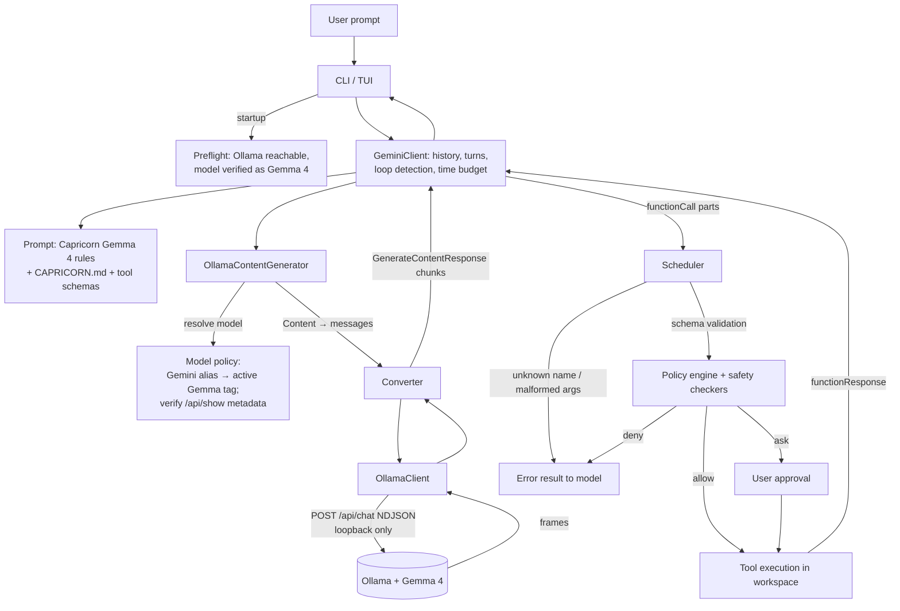

# Architecture

Capricorn is an npm-workspaces TypeScript monorepo inherited from Gemini CLI
(see [ADR 0001](adr/0001-foundation.md)). The published artifact is a single
esbuild bundle, `bundle/capricorn.js`.

## Packages

| Package (internal name)                                                                     | Role                                                                       |
| ------------------------------------------------------------------------------------------- | -------------------------------------------------------------------------- |
| `packages/cli` (`@capricorn/cli`)                                                           | Argument parsing, subcommands, Ink/React TUI, headless mode, settings      |
| `packages/core` (`@capricorn/core`)                                                         | Agent loop, tools, scheduler, policy, sessions, MCP, **Ollama provider**   |
| `packages/test-utils`, `packages/sdk`, `packages/devtools`, `packages/vscode-ide-companion` | Retained upstream packages (not part of the Capricorn product surface yet) |

## Responsibilities and where they live

| Concern                 | Location                                                                                                                                      |
| ----------------------- | --------------------------------------------------------------------------------------------------------------------------------------------- |
| CLI / TUI               | `cli/src/main.tsx`, `cli/src/ui/`, `cli/src/commands/capricorn.ts`                                                                            |
| Startup preflight       | `cli/src/capricorn/preflight.ts`                                                                                                              |
| Diagnostics (`doctor`)  | `cli/src/capricorn/diagnostics.ts`                                                                                                            |
| Agent orchestrator      | `core/src/core/client.ts` (`GeminiClient`), `geminiChat.ts`, `turn.ts`; cited-files follow-up `citedFiles.ts`                                 |
| Provider contract       | `core/src/core/contentGenerator.ts` (`ContentGenerator`)                                                                                      |
| Ollama transport        | `core/src/providers/ollama/client.ts`, `ndjson.ts`, `endpoint.ts`, `errors.ts`                                                                |
| Gemma 4 adaptation      | `providers/ollama/modelPolicy.ts`, `converter.ts`, `ollamaContentGenerator.ts`, `prompts/capricornSnippets.ts`                                |
| Tool registry and tools | `core/src/config/config.ts` (`createToolRegistry`), `core/src/tools/`                                                                         |
| Scheduler / validation  | `core/src/scheduler/scheduler.ts`                                                                                                             |
| Security layer          | `core/src/policy/`, `core/src/safety/`, `core/src/security/egressGuard.ts`, `cli/src/capricorn/networkPolicy.ts`, `cli/src/utils/sandbox*.ts` |
| Persistence             | `core/src/config/storage.ts`, `core/src/services/chatRecordingService.ts`, `cli/src/config/settings.ts`                                       |
| Context management      | `core/src/context/`, `core/src/core/tokenLimits.ts`                                                                                           |

## Request data flow

Every TCP connection the process opens passes the egress guard
(`net.Socket#connect`), which allows loopback plus user-approved hosts only.

## Key invariants

1. **No hosted inference path.** `createContentGenerator` can only build the
   Ollama generator (or test fakes). The endpoint is validated before any
   traffic; non-loopback endpoints need a _user-scope_ opt-in.
2. **Only verified Gemma 4 receives prompts.** Every request resolves to an
   Ollama tag that passed `verifyGemma4Model` (architecture metadata, not name;
   cloud models always refused). Verification is cached per session; failures
   are not.
3. **Model output is untrusted.** Tool names are syntax-checked, arguments must
   be JSON objects (malformed → marker → scheduler rejection), then the tool's
   JSON schema validates them, then the policy engine decides.
4. **Streaming correctness.** A stream that ends without `done: true` raises
   `STREAM_TRUNCATED`; retries happen only before any chunk was yielded.
5. **Honest context accounting.** `tokenLimit()` equals the allocated `num_ctx`;
   token counts are estimates calibrated by real `prompt_eval_count`, and are
   labelled as estimates.

## Protocol mapping (summary)

See the table at the top of `providers/ollama/converter.ts` for the full mapping
and the reasoning behind each conversion (system instruction,
`model`→`assistant`, function calls/responses, thoughts, images, schemas, finish
reasons and usage).

## Configuration precedence

CLI flags → environment variables → system settings (overrides) → project
`.capricorn/settings.json` (trusted folders only) → user
`~/.capricorn/settings.json` → system defaults → built-in defaults. A small set
of invariants is applied after merging and cannot be overridden (see
[CONFIGURATION.md](CONFIGURATION.md#non-overridable-settings)).
